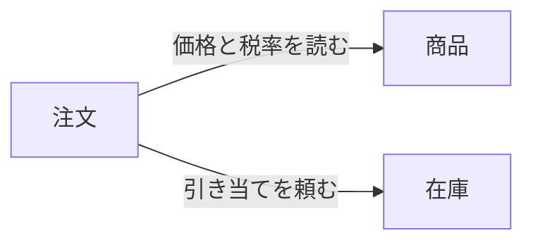
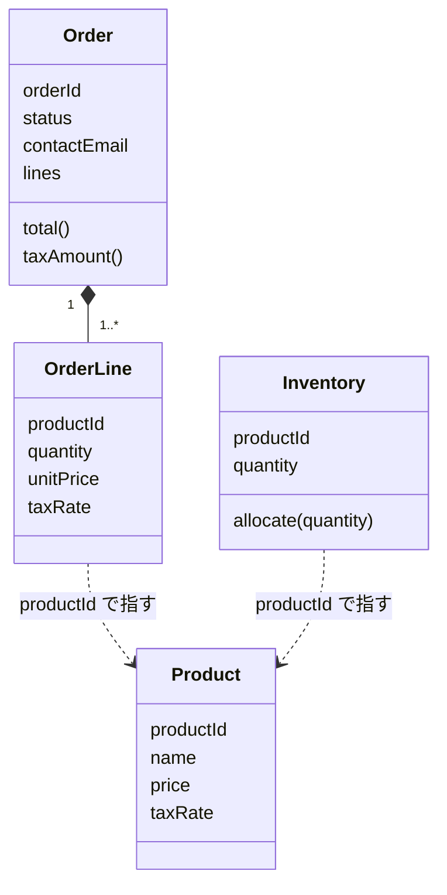

# ドメインモデル

1 周目 (注文する・注文を確かめる) のドメインモデル。語は用語集 (docs/glossary.yaml) の語にそろえ、クラス図の名前は用語集の code にそろえる (lines は注文明細 OrderLine の並び)。

## 境界づけられたコンテキスト

| コンテキスト | 受け持つこと | 1 周目に使う語 |
| --- | --- | --- |
| 注文 | 注文を受け付け、注文の内容と状態を持つ | 注文・注文明細・単価・合計・消費税額・受付・連絡先メールアドレス |
| 在庫 | 商品ごとの、注文に引き当てられる数量を持つ | 在庫・引き当て |
| 商品 | 注文できる品物と、その価格と税率を持つ | 商品・価格・税率 |

注文は、商品の価格と税率を読んで注文明細に写し、在庫に引き当てを頼む。矢印は、頼る側から頼られる側へ向ける。

## 集約

| 集約 | 集約ルート | 中に持つもの | 不変条件 (存在する間ずっと成り立つ決まり) |
| --- | --- | --- | --- |
| 注文 | Order | 注文明細 (OrderLine) | 注文明細は 1 つ以上。どの注文明細の数量も 1 以上。合計は、注文明細ごとの単価と数量の積の和。消費税額は、税率ごとの合計から割り戻した額の和 (1 円未満は切り捨て、端数処理は税率ごとに 1 回) |
| 在庫 | Inventory | (なし) | 数量は 0 以上 |
| 商品 | Product | (なし) | 価格は 0 以上の円の整数。税率は 8% か 10% |

不変条件のほかに、作るときと操作の決まりがある。

- 注文は、受付の状態で作る
- 在庫の引き当ては、そのときの数量を超える数量を断る。数量を 0 以上に保つための決まりで、断るのは業務の失敗 (在庫が足りない) として扱う

集約は、その中の不変条件を 1 つのトランザクションで守る範囲 (整合性の境界) になる。

ほかの集約は ID で指す。注文明細は商品を商品 ID で指し、注文した時点の商品の価格と税率を写して持つ。在庫は商品を商品 ID で指す。

## エンティティと値オブジェクト

| 種類 | もの | 理由 |
| --- | --- | --- |
| エンティティ | 注文・在庫・商品 | 中身が変わっても同じものとして追う (注文の状態が変わる、在庫の数量が変わる、商品の価格が変わる) |
| 値オブジェクト | 注文明細・注文 ID・商品 ID・数量・金額・税率・連絡先メールアドレス | 中身が同じなら区別しない。作った後に変えない |

注文明細は、注文の外から注文明細だけを指すことが無く、1 周目では作った後に変えないので、値オブジェクトにする。

## トランザクション

1 つのトランザクションでは、1 つの集約インスタンスだけを変えるのを原則にする。

1 周目の注文するでは、例外として、注文 1 つと、頼んだ商品ごとの在庫を、1 つのトランザクションで変える (受け入れ条件の注文なら、注文 1 つと在庫 2 つ)。途中で失敗しても、在庫だけが減って注文が無い状態や、注文があるのに在庫が減っていない状態を作らないため。

ほかの形を選ばない理由:

- 在庫を後から引き当てる形 (結果整合): 受け付けたと答えた注文を、在庫が足りないと後から断ることになり、受け入れ条件と合わない
- 引き当てと注文の記録を別々のトランザクションで続けて行い、後のほうが失敗したら引き当てを戻す形: 答える時点では受け入れ条件を満たせるが、戻す前に処理が止まると在庫だけが減ったまま残り、それを見つけて直す仕組みが別に要る。1 周目は注文と在庫を 1 つのデータベースに置くので、1 つのトランザクションで済ませる

代償として、同じ商品への同時の注文が在庫を取り合う。1 つの注文で複数の商品の在庫を変えるので、注文どうしが互いを待ち続けないよう、在庫を変える順をそろえる必要もある。

## クラス図

