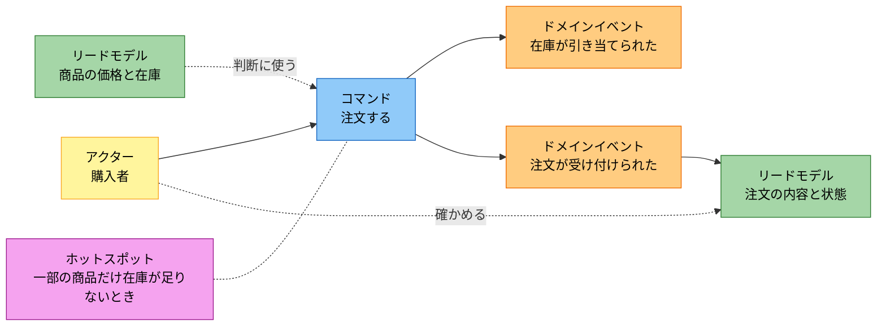

# イベントストーミングの記録

1 周目 (注文する・注文を確かめる) で起きる出来事を、時系列に並べたもの。付箋の語は、用語集 (docs/glossary.yaml) の語にそろえる。

## ボード

付箋の種類を色で分ける (凡例: アクターは黄色、コマンドは青、ドメインイベントはオレンジ、リードモデルは緑、ホットスポットはマゼンタ)。色だけに頼らないよう、種類をノードの先頭にも書く。左から右へ時間が流れ、同じときに起きる出来事は縦に並べる。リードモデルには、API で扱うかどうかに関わらず、業務の判断に使う情報を書く。

## ホットスポットと決めたこと

| ホットスポット | 決めたこと | 理由 |
| --- | --- | --- |
| 2 種類以上の商品を頼み、一部の商品だけ在庫が足りないとき、注文全体を断るか、足りる注文明細だけで受け付けるか | 注文全体を断り、在庫が足りない商品を返す。どの商品の在庫も変えない | 購入者は商品をまとめて頼んでいて、一部だけを受け付けると購入者の意図と違いうる。一部だけを受け付けると、合計と消費税額が、購入者が見込んだ額から変わる。断られた購入者は、数量を変えて頼み直せる |

決めたことは、要件に戻して書いた (docs/requirements/use-cases.md の別の流れ 4a と、docs/requirements/stories.md の受け入れ条件「一部の商品の在庫が足りないと、注文全体が受け付けられない」)。

## 出来事にしなかったこと

在庫が足りないときや、入力に誤りがあるときは、注文するコマンドが断られ、出来事は起きない。断られる条件は、ユースケースの別の流れと受け入れ条件に書いてある。
